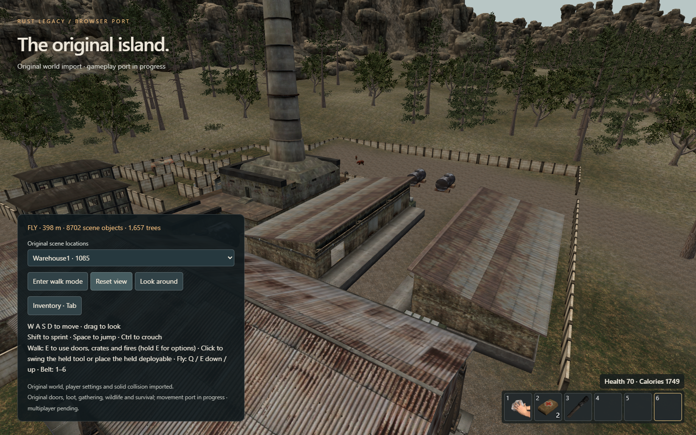
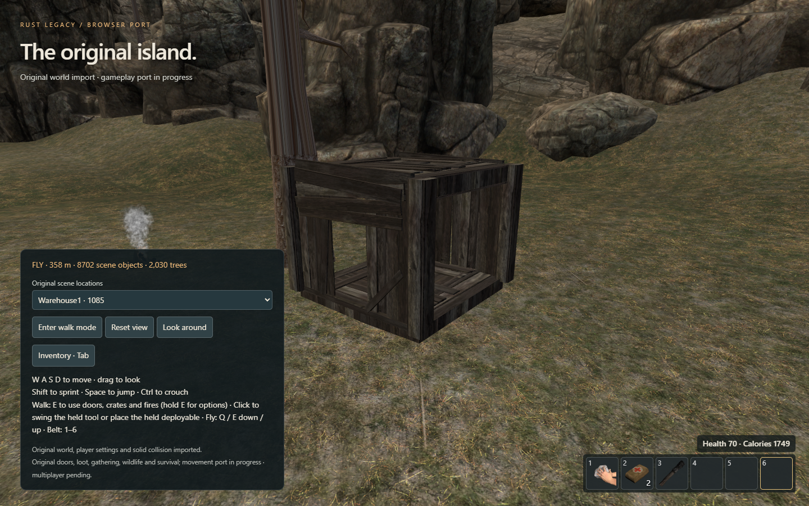
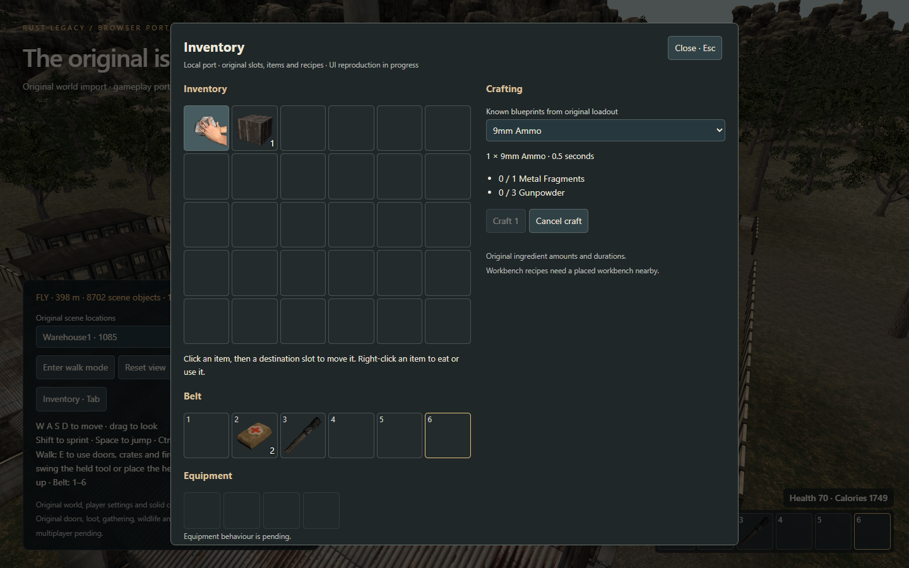

  
  
  

<strong>The original island. The familiar survival experience. A browser as the destination.</strong>

This project aims to bring **Rust Legacy into a modern browser**, preserving its original world and gameplay rather than designing a different survival game. Created and led by **[Complicatons](https://github.com/Complicatons)**, with AI-assisted development.

This repository is the project's public development journal: real prototype screenshots, dated milestones, architectural plans and a roadmap. The implementation is maintained privately. **There is no public playable release yet**, and compatibility with existing Legacy servers has not been demonstrated.

<a href="docs/DEVLOG.md">Development journal</a> · <a href="docs/ROADMAP.md">Roadmap</a> · <a href="docs/ARCHITECTURE.md">Accounts & servers</a> · <a href="docs/PROJECT-ORIGIN.md">Project origin</a>

## Inside the prototype

*Actual local prototype, 17 October 2026. Development controls are visible; the interface is unfinished.*

The private development history records work on:

| Area | Local prototype work |
| :--- | :--- |
| Original world | Client scene import, terrain, rock formations, collision and doors |
| Survival | Gathering, wildlife, hunting, hunger, bleeding, food, medical items, night cold and radiation |
| Items & crafting | Inventory, loot, recipes and item interactions; online inventory/crafting UI checked through the mock server |
| Player-made world | Building pieces, placement, doors, deployables and sleeping bags |
| Camp life | Campfires, cooking, furnaces, storage and workbenches |
| Combat | Firearms, bows, grenades, explosive charges and wearable armour |
| Player presentation | Original first-person models/clips, remote-player clothing and unarmed movement animations |
| Online prototype | Website/gateway/adapter join through a mock server, server buildings/resources/fire effects and wildlife presentation |
| Environment | Recovered day/night clock, changing lighting, fire warmth and radiation zones |

These are development milestones, not a claim of complete fidelity or release readiness. Multiplayer, native server compatibility, security and browser performance still need substantial validation.

<table>
<tr>
<td width="50%"></td>
<td width="50%"></td>
</tr>
<tr><td align="center">Building in the original environment</td><td align="center">Inventory and item interactions</td></tr>
</table>

## Where this is going

The intended experience is straightforward: visit the website, sign in, browse community servers and join from the browser. Your stable account identity would let each server recognise you across sessions and IP changes. Each server would retain its own world, inventory and progression, subject to that server's wipe policy.

**For the first release, server owners will need to install our browser connection package.** Browser players need a website account and no installed client; existing desktop players may optionally link their character to use that same server identity in the browser. Read [the guide for players and server owners](docs/PLAYERS-AND-SERVER-OWNERS.md) for the planned steps and requirements.

The planned system combines a browser client, website accounts, a server directory and a bridge operated alongside each participating game server. Existing Legacy servers would need a compatible bridge and verified protocol support before browser players could join. [Read the proposed hosting design →](docs/ARCHITECTURE.md)

## Follow the work

- **Watch** this repository for documentation and progress updates.
- Read the [dated journal](docs/DEVLOG.md) and [delivery roadmap](docs/ROADMAP.md).
- Use [issues](https://github.com/Complicatons/rust-legacy-browser/issues) for feedback and well-documented suggestions. Please read [the contribution guide](CONTRIBUTING.md) first.

The first recorded development commits are dated **16 October 2026**. This public journal begins **17 October 2026**. [The origin record](docs/PROJECT-ORIGIN.md) identifies the private source snapshot behind this first publication without exposing its contents.

---

**Unofficial community project.** Rust Legacy and its original content belong to their respective rights holders. This project is not affiliated with or endorsed by Facepunch. No original game files, recovered assets or server binaries are distributed here. See [rights and attribution](RIGHTS.md) and [publication policy](docs/PUBLICATION-POLICY.md).
