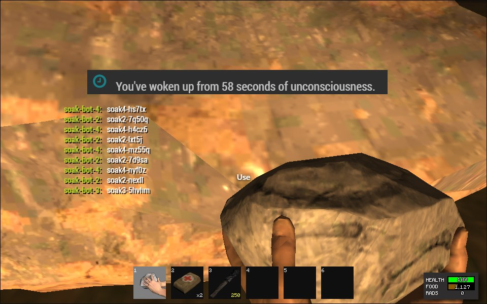
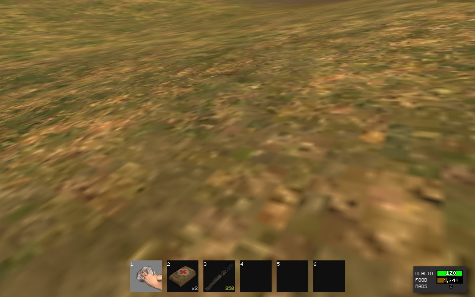
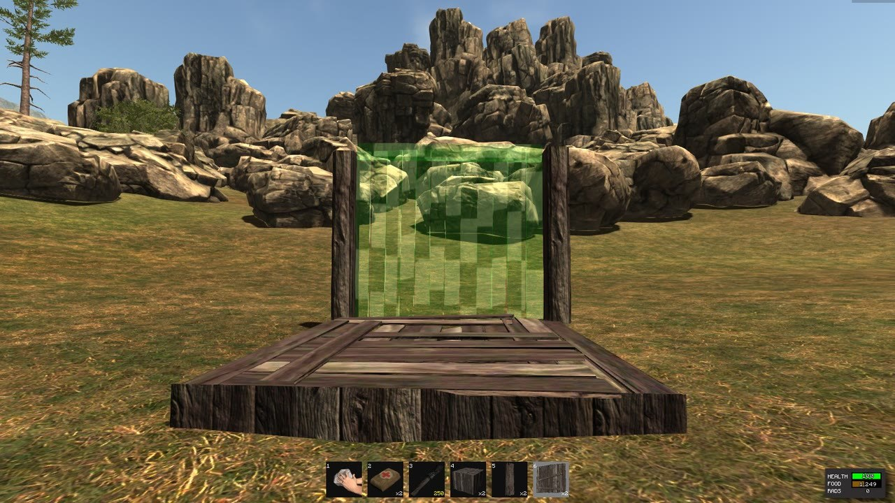
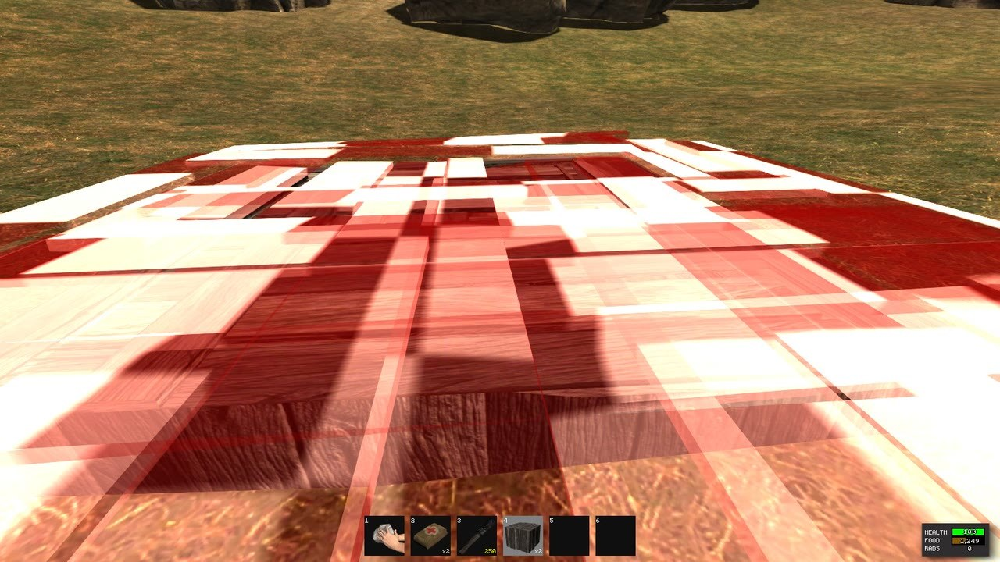
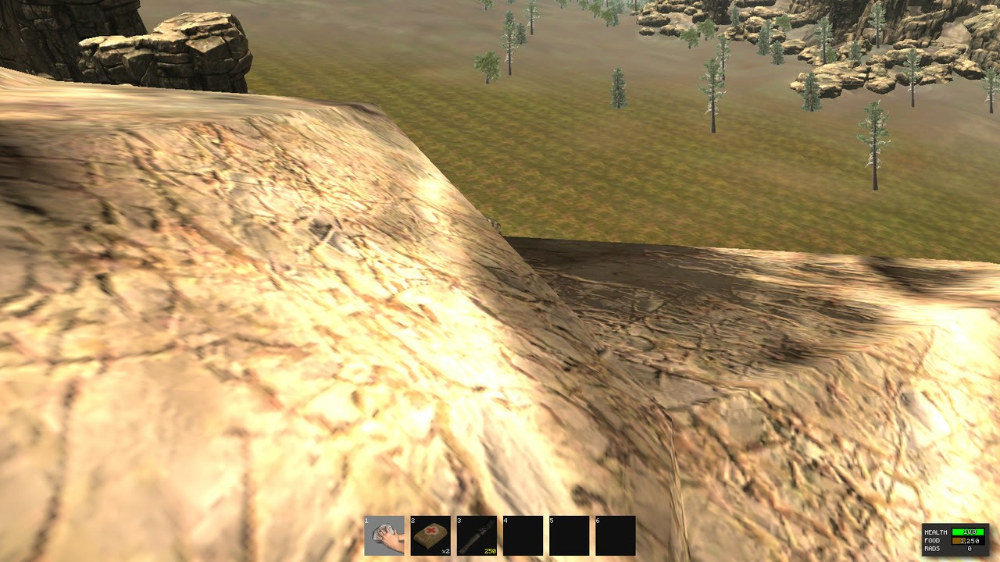
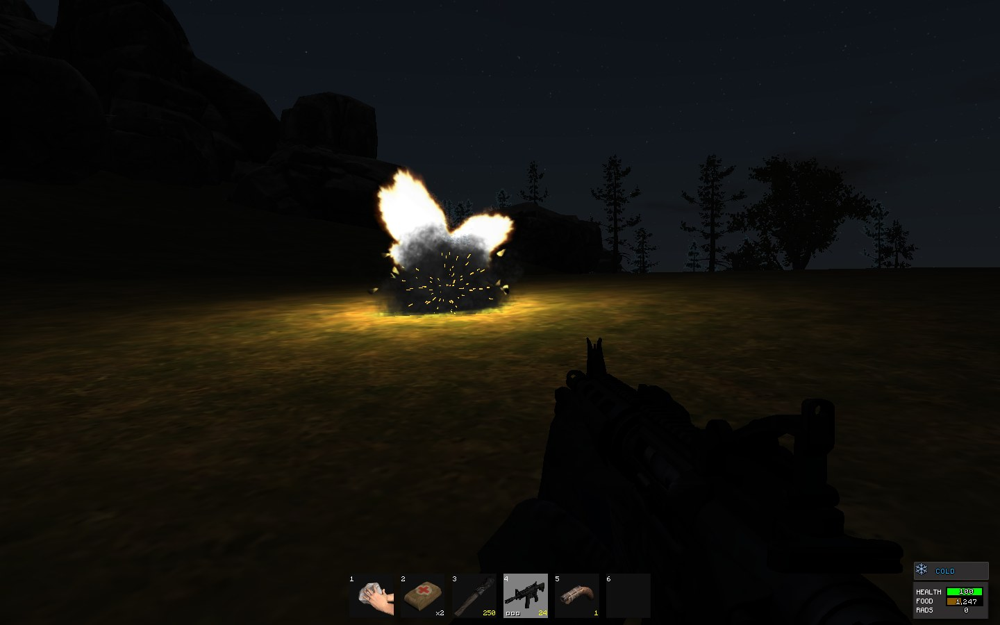
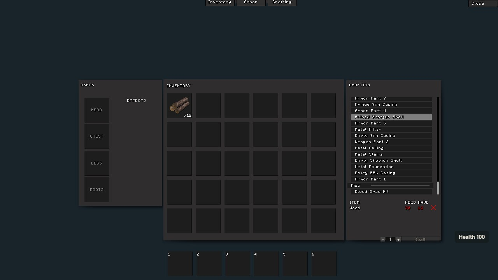
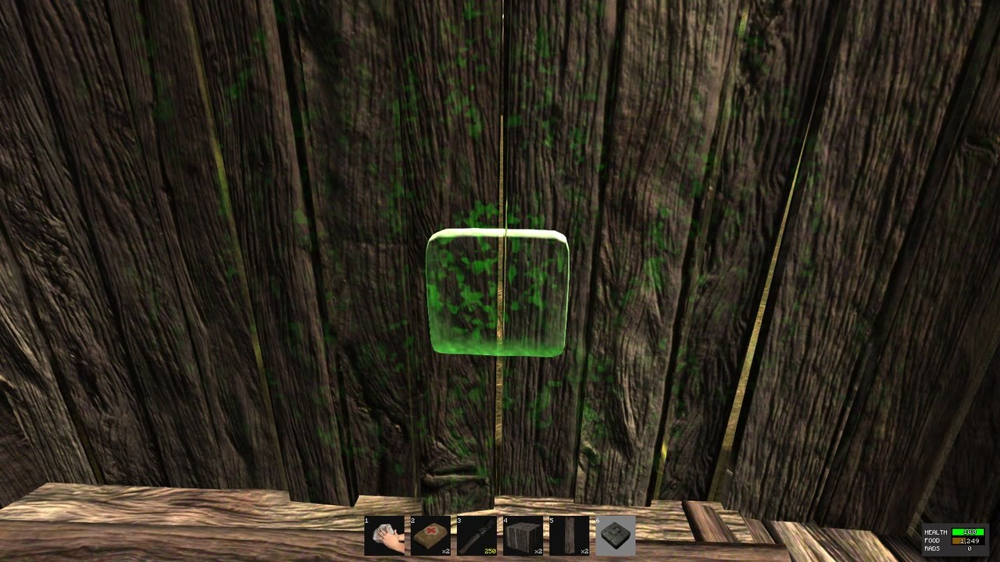
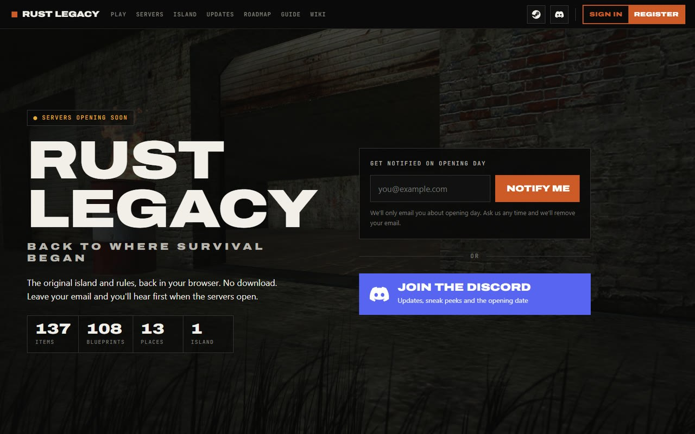
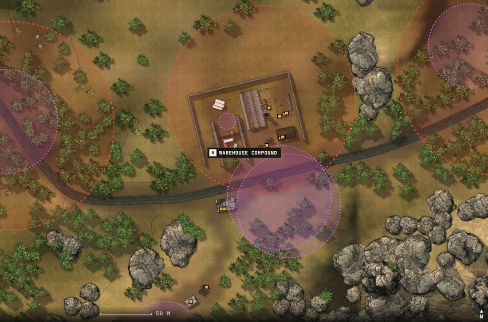

<p align="center"></p>

<p align="center">
  
  
  <a href="https://rustlegacy.co.uk"></a>
  
</p>

<p align="center"><strong>The original island. The familiar survival experience. Nothing to download.</strong></p>

**Rust Legacy, running in a modern browser.** This project brings back the original Rust Legacy world and gameplay rather than designing a new survival game. You open a web page and play. You don't need a launcher, a loader or an executable. Created and led by **[Complicatons](https://github.com/Complicatons)**, with AI-assisted development.

This repository is the public development journal: real screenshots, progress and the roadmap. The game's code is kept private.

**The website is live at [rustlegacy.co.uk](https://rustlegacy.co.uk)**, with the wiki, the island map, the full dated roadmap and [opening-day sign-ups](https://rustlegacy.co.uk/launch). Join the [Discord](https://discord.gg/4NjPbkFnpf) to follow along.

<p align="center"><a href="docs/SCREENSHOTS.md"><b>Screenshots</b></a> · <a href="docs/ROADMAP.md"><b>Roadmap</b></a> · <a href="docs/DEVLOG.md"><b>Development journal</b></a> · <a href="docs/PLAYERS-AND-SERVER-OWNERS.md"><b>Players & server owners</b></a> · <a href="docs/SERVER-FILE-SCANS.md"><b>Server file scans</b></a></p>


*The original warehouse compound, rendered in the browser (20 October 2026 build).*

<p align="center"><a href="assets/video/gameplay-tour-2026-10-20-v4.mp4"></a></p>

<p align="center"><a href="assets/video/gameplay-tour-2026-10-20-v4.mp4"><b>▶ Download the 3½-minute gameplay video (MP4, 53 MB)</b></a>: the original menus, gathering, crafting, building a full base, guns, hunting, wildlife, raiding, multiplayer, night time and airdrops, with in-game sound.</p>

<table>
<tr>
<td align="center" width="25%"><h2>83%</h2><sub>overall progress</sub></td>
<td align="center" width="25%"><h2>917</h2><sub>automated tests passing</sub></td>
<td align="center" width="25%"><h2>0</h2><sub>kicks in a 22-minute run on the original server</sub></td>
<td align="center" width="25%"><h2>3 s</h2><sub>to rejoin the island</sub></td>
</tr>
</table>

## Latest updates — 21 & 22 October

### Browser players on the original server

For the first time, a player in a web browser joined the **original 2014 Rust Legacy server** and spawned on the island. It ran on a sealed-off test machine in the cloud. Since then, browser players have gathered resources and received the server's own starting items. Four test bots played for **22 minutes with no anti-cheat kicks and no disconnects**.

<table>
<tr>
<td width="50%"></td>
<td width="50%"></td>
</tr>
<tr><td>Test run on the original server: gathering sulfur ore with the Rock</td><td>Test run on the original server: the Rock, Bandages and Torch it gives every new player</td></tr>
</table>

### A more solid, more faithful game

The island's **8,344 rocks and cliffs are now solid** for players, bullets and building, and you slide along them the way the original moved you. Building pieces show the **original pulsing green/red preview**. Guns drift while you aim, bullets spark on metal, explosions flash the way they did, and grenades bounce and roll.

<table>
<tr>
<td width="50%"></td>
<td width="50%"></td>
</tr>
<tr><td>The original building preview: green where a wall fits…</td><td>…and red where a foundation doesn't</td></tr>
<tr>
<td></td>
<td></td>
</tr>
<tr><td>Standing on a rock 39 m above the ground: rocks are solid now</td><td>An F1 grenade at night: the original quarter-second flash</td></tr>
<tr>
<td></td>
<td></td>
</tr>
<tr><td>The crafting list scrolls with the original scroll bar and button colours</td><td>Aiming an explosive charge: the target lights up, as in the original</td></tr>
</table>

### Much faster loading

Joining from a remote server now takes **25 seconds instead of 83**, and a return visit loads in about **3 seconds**. The download dropped from 210 MB to 167 MB with the same picture. The game is now tested in **Firefox and Chrome** as well as Edge, and it plays in fullscreen so crouch-walking with Ctrl+W can't close the tab.

### The website is live

**[rustlegacy.co.uk](https://rustlegacy.co.uk)** is up on our own server in London. It has accounts, the server list, a **wiki with 39 guides and a resource calculator**, a detailed **island map**, the dated roadmap and [opening-day sign-ups](https://rustlegacy.co.uk/launch). No game servers are listed yet.

<table>
<tr>
<td width="50%"></td>
<td width="50%"></td>
</tr>
<tr><td>The launch page: get notified or join the Discord</td><td>The detailed island map, drawn from the game's own rocks, buildings and trees</td></tr>
</table>

**[All the new screenshots, with labels →](docs/SCREENSHOTS.md)** · **[Full update history →](https://rustlegacy.co.uk/roadmap)**

## Progress — 22 October 2026

```text
Overall   █████████████████░░░  83%
```

| Area | Progress | Working now | Left to do |
| :--- | :--- | :--- | :--- |
| **Original world and graphics** | `█████████░` 92% | The original island with all its buildings, rocks and trees, with the 8,344 rocks and cliffs solid. Day/night sky, stars and moon, the original sea with reflections, original lighting and shaders, grass, shadows and six quality presets | Final side-by-side comparison with the original |
| **Survival, gathering and wildlife** | `██████████` 95% | Gathering, 61 blueprints, crafting, hunger, bleeding, radiation, cold, cooking, research kits, loot crates. Chickens, rabbits, boar, stags, wolves, bears and mutants with the original AI | Small behaviour differences |
| **Building and raiding** | `█████████░` 93% | Foundations to roofs, doors, code locks, storage, sleeping bags, decay, the original placement preview, and raiding with grenades and C4 using the original damage rules | Building and raiding tests on the original server |
| **Weapons and combat** | `█████████░` 92% | Rifles, pistols, shotguns, bows, hand cannon, grenades and C4. Sights, silencer, flashlight and laser. Recoil, aim drift, draw sounds, muzzle flash, tracers, impacts, metal sparks, explosion flashes, rolling grenades, ragdolls and hit markers | Ragdoll joint limits; combat tests on the original server |
| **Menus, HUD and social** | `█████████▌` 97% | Original main menu, options, key rebinding, server browser and loading screen. Inventory windows with the original scrolling, button colours and sounds, F1 console, chat, push-to-talk voice and name tags | Code-lock dialog styling; small UI polish |
| **Online play** | `█████████░` 90% | The server controls inventory, crafting, building, combat, vitals, airdrops and wildlife, tested against our own test server and now partly against the original | The rest of the gameplay checks on the original server |
| **First real server** | `████▌░░░░░` 45% | Browser players join the original server on a sealed-off cloud test machine, gather, and get the server's starting items; 4 bots ran 22 minutes with no kicks | Crafting, building and combat checks, long multi-player runs, then installing on the public game server |
| **Website, accounts and server list** | `████████▌░` 85% | Live at rustlegacy.co.uk: accounts (username/password or Steam), server list, wiki with 39 guides and a calculator, island map, roadmap and opening-day sign-ups | Discord sign-in and account emails; listing the first game server |
| **Anti-cheat and admin tools** | `███████░░░` 70% | Server-side checks for wall shots, noclip, aim snapping and spam. Admin roles, bans, reports and an audit log, with every admin action tested end to end | Tuning with real players |
| **Performance and release polish** | `███████▌░░` 75% | First join in 25 s (was 83 s), return visits in about 3 s, 167 MB download, tested in Edge, Firefox and Chrome, stable over a 20-minute play test | Lower-end hardware |

*The percentages are the project's own estimates, weighted by how much each area matters for a playable public server.*

## Screenshots

**[See all screenshots, with labels →](docs/SCREENSHOTS.md)**

<table>
<tr>
<td width="50%"></td>
<td width="50%"></td>
</tr>
<tr><td align="center">The original main menu, in the browser</td><td align="center">Server browser</td></tr>
<tr>
<td></td>
<td></td>
</tr>
<tr><td align="center">M4 with holo sight</td><td align="center">Bear in the warehouse yard</td></tr>
<tr>
<td></td>
<td></td>
</tr>
<tr><td align="center">Sunset over the original sea</td><td align="center">Airdrop plane</td></tr>
<tr>
<td></td>
<td></td>
</tr>
<tr><td align="center">Raiding</td><td align="center">Inventory, armor and crafting</td></tr>
<tr>
<td></td>
<td></td>
</tr>
<tr><td align="center">Field of View slider (60–120) and FPS counter option</td><td align="center">FPS counter in game (top right)</td></tr>
</table>

## What happens next

1. **Finish testing on the original server.** Crafting, building, combat and long runs with several players. Joining and gathering already work.
2. **Install on the public game server.** The machine is ordered and running; the original server and our bridge go on it next.
3. **First PvP server.** Open a PvP server for the community, followed by an EU server.
4. **Community decisions.** Wipe schedule, group limits and server rules are being decided with the players on [Discord](https://discord.gg/4NjPbkFnpf).
5. **Desktop players.** A launcher so the same website account can join from the original desktop game too.

See the [roadmap](docs/ROADMAP.md) for detail.

## How it will work for players

Visit the website, sign in, choose a server, play. Your account keeps your identity across sessions, so servers recognise you even when your IP changes. Each server keeps its own world, inventory and wipe schedule.

Because the game runs in the browser, there is nothing to install. You don't need a third-party launcher or a modified client to join. [Guide for players and server owners →](docs/PLAYERS-AND-SERVER-OWNERS.md)

## Follow the project

- **Sign up** at [rustlegacy.co.uk/launch](https://rustlegacy.co.uk/launch) to hear when the servers open.
- **Join** the [Discord](https://discord.gg/4NjPbkFnpf).
- **Watch** this repository for updates.
- Read the [development journal](docs/DEVLOG.md).
- Use [issues](https://github.com/Complicatons/rust-legacy-browser/issues) for feedback and suggestions. Please read [the contribution guide](CONTRIBUTING.md) first.

The first development commits are dated **16 October 2026**. This public journal started on **17 October 2026**. [Project origin →](docs/PROJECT-ORIGIN.md)

---

**Unofficial community project.** Rust Legacy and its original content belong to their respective rights holders. This project is not affiliated with or endorsed by Facepunch. No original game files, recovered assets or server binaries are distributed here. The original server files used for testing were security-checked: [server file scans](docs/SERVER-FILE-SCANS.md). See [rights and attribution](RIGHTS.md) and the [publication policy](docs/PUBLICATION-POLICY.md).
