<p align="center">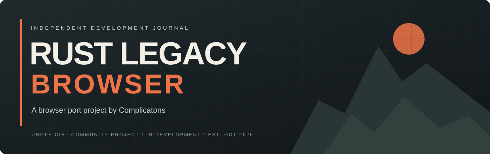</p>

<p align="center">
  
  
  
</p>

<p align="center"><strong>The original island. The familiar survival experience. Nothing to download.</strong></p>

**Rust Legacy, running in a modern browser.** This project brings back the original Rust Legacy world and gameplay rather than designing a new survival game. You open a web page and play. You don't need a launcher, a loader or an executable. Created and led by **[Complicatons](https://github.com/Complicatons)**, with AI-assisted development.

This repository is the public development journal: real screenshots, progress and the roadmap. The game's code is kept private.

<p align="center"><a href="docs/SCREENSHOTS.md"><b>Screenshots</b></a> · <a href="docs/ROADMAP.md"><b>Roadmap</b></a> · <a href="docs/DEVLOG.md"><b>Development journal</b></a> · <a href="docs/PLAYERS-AND-SERVER-OWNERS.md"><b>Players & server owners</b></a></p>

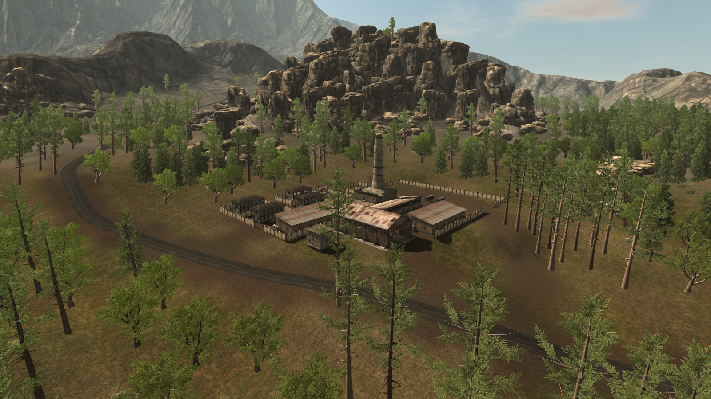

*The original warehouse compound, rendered in the browser (20 October 2026 build).*

<p align="center"><a href="assets/video/gameplay-tour-2026-10-20-v3.mp4">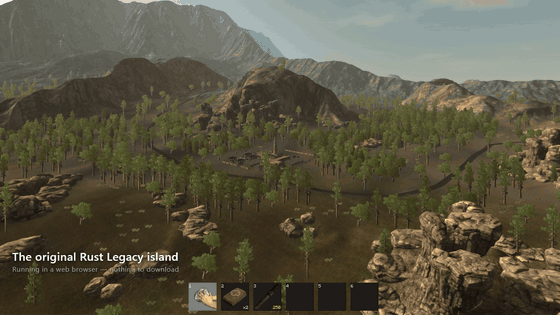</a></p>

<p align="center"><a href="assets/video/gameplay-tour-2026-10-20-v3.mp4"><b>▶ Download the 3½-minute gameplay video (MP4, 52 MB)</b></a>: the original menus, gathering, crafting, building, guns, hunting, wildlife, raiding, multiplayer, night time and airdrops, with in-game sound.</p>

<table>
<tr>
<td align="center" width="25%"><h2>76%</h2><sub>overall progress</sub></td>
<td align="center" width="25%"><h2>614</h2><sub>automated tests passing</sub></td>
<td align="center" width="25%"><h2>186</h2><sub>original items</sub></td>
<td align="center" width="25%"><h2>8</h2><sub>original animals</sub></td>
</tr>
</table>

## Progress — 20 October 2026

```text
Overall   ███████████████░░░░░  76%
```

| Area | Progress | Working now | Left to do |
| :--- | :--- | :--- | :--- |
| **Original world and graphics** | `█████████░` 90% | The original island with all its buildings, rocks and trees. Day/night sky, stars and moon, the original sea with reflections, original lighting and shaders, grass, shadows and six quality presets | Texture compression for faster loading; final side-by-side comparison with the original |
| **Survival, gathering and wildlife** | `██████████` 95% | Gathering, 61 blueprints, crafting, hunger, bleeding, radiation, cold, cooking, research kits, loot crates. Chickens, rabbits, boar, stags, wolves, bears and mutants with the original AI | Small behaviour differences |
| **Building and raiding** | `█████████░` 90% | Foundations to roofs, doors, code locks, storage, sleeping bags, decay, and raiding with grenades and C4 using the original damage rules | Final comparison against the original |
| **Weapons and combat** | `█████████░` 88% | Rifles, pistols, shotguns, bows, hand cannon, grenades and C4. Sights, silencer, flashlight and laser. Recoil, muzzle flash, tracers, impacts, ragdolls and hit markers | Ragdoll joint limits; animation polish |
| **Menus, HUD and social** | `█████████░` 92% | Original main menu, options, key rebinding, server browser and loading screen. Inventory windows, F1 console, chat, push-to-talk voice and name tags | Code-lock dialog styling; small UI polish |
| **Online play** | `████████░░` 85% | The server controls inventory, crafting, building, combat, vitals, airdrops and wildlife. All of it is tested against our own test server | Testing against a real Legacy server (see below) |
| **First real server** | `█░░░░░░░░░` 10% | The connection bridge between browser players and a Legacy server is built | Run it against a real server, then open the first PvP server |
| **Website, accounts and server list** | `████▌░░░░░` 45% | Sign-in, a server directory and one-click join work locally. The new website is designed | Build and launch the new website |
| **Anti-cheat and admin tools** | `█████▌░░░░` 55% | Server-side checks for wall shots, noclip, aim snapping and spam. Admin roles, bans and an audit log | Tuning with real players |
| **Performance and release polish** | `█████░░░░░` 50% | Distance culling, tree LOD and stable frame pacing on a desktop GPU | A wider range of hardware and browsers; loading time |

*The percentages are the project's own estimates, weighted by how much each area matters for a playable public server.*

## Screenshots

**[See all screenshots, with labels →](docs/SCREENSHOTS.md)**

<table>
<tr>
<td width="50%">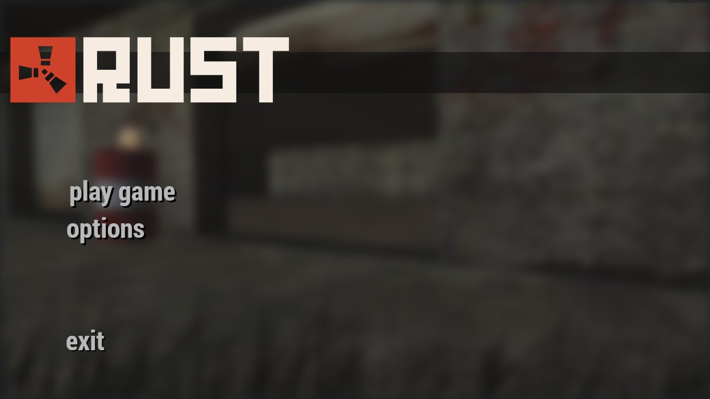</td>
<td width="50%">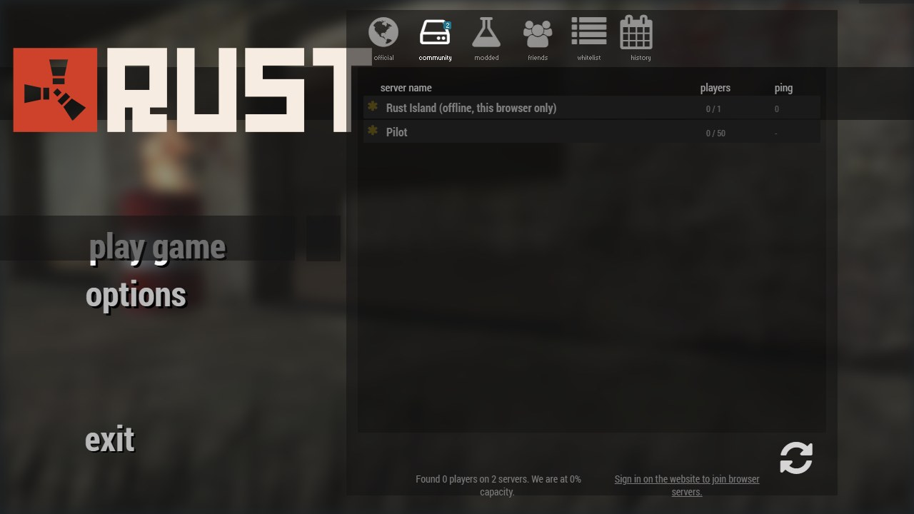</td>
</tr>
<tr><td align="center">The original main menu, in the browser</td><td align="center">Server browser</td></tr>
<tr>
<td>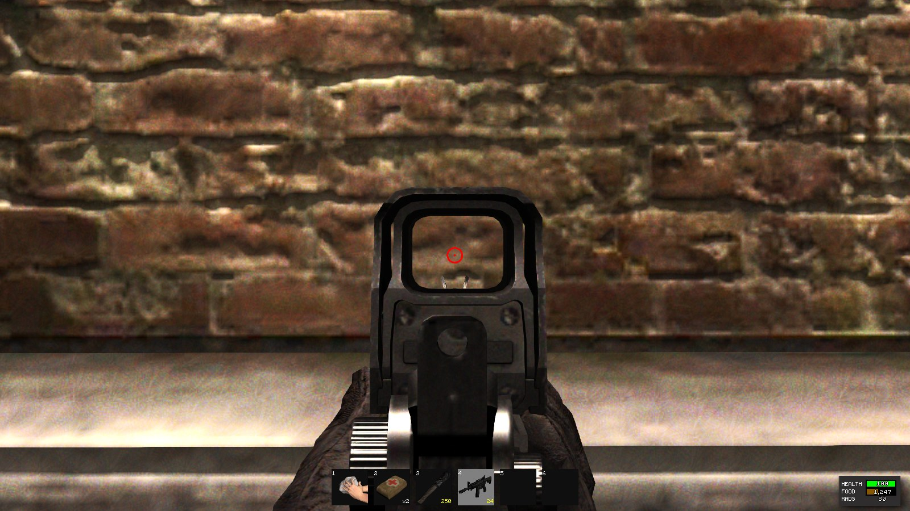</td>
<td>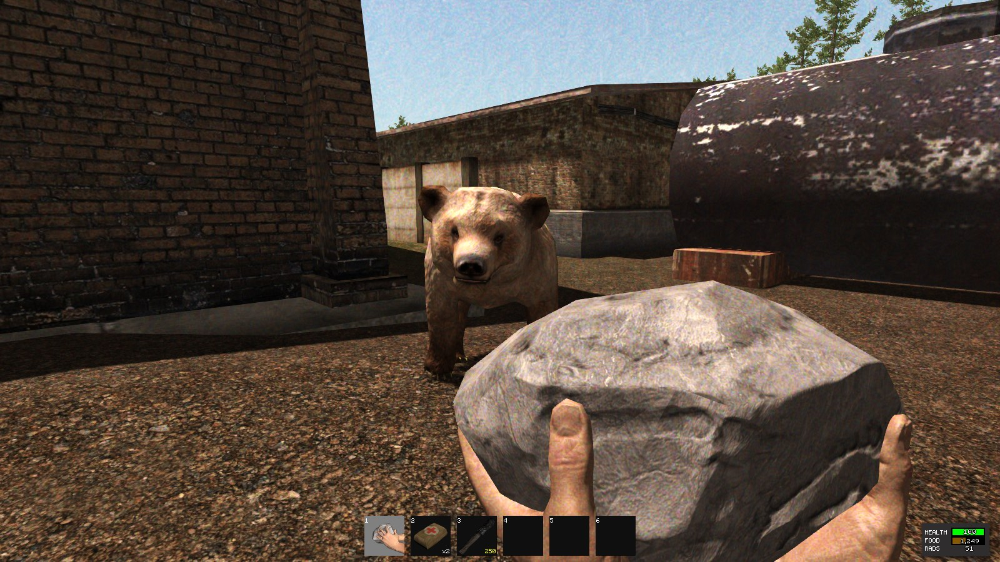</td>
</tr>
<tr><td align="center">M4 with holo sight</td><td align="center">Bear in the warehouse yard</td></tr>
<tr>
<td>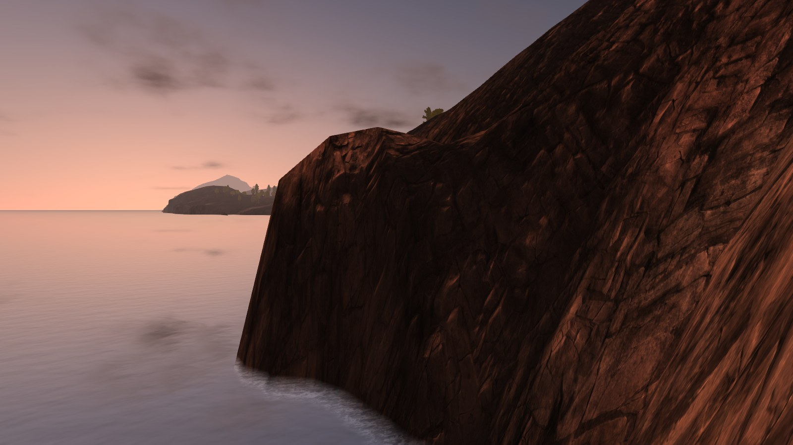</td>
<td>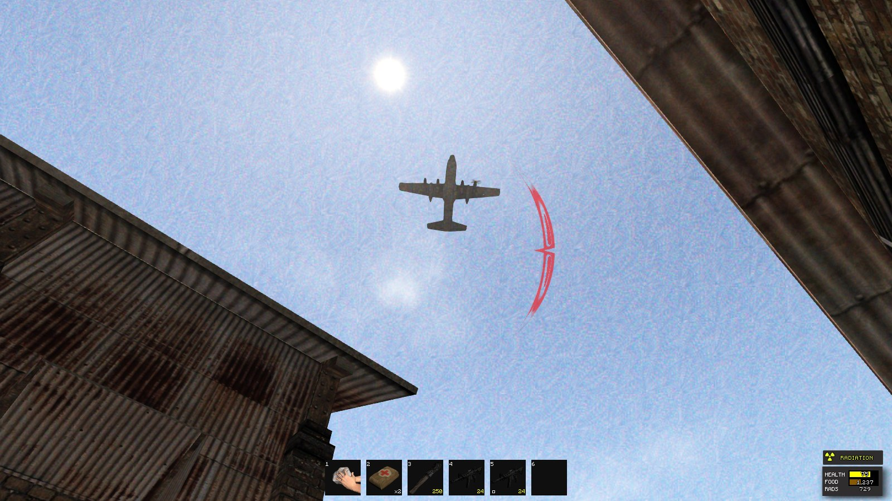</td>
</tr>
<tr><td align="center">Sunset over the original sea</td><td align="center">Airdrop plane</td></tr>
<tr>
<td>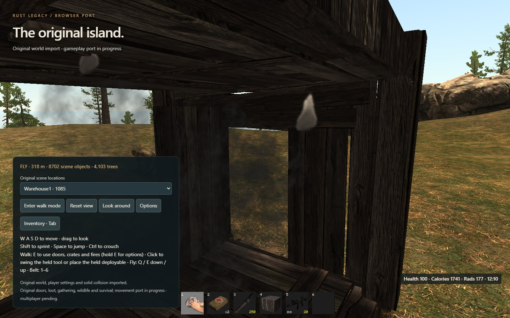</td>
<td>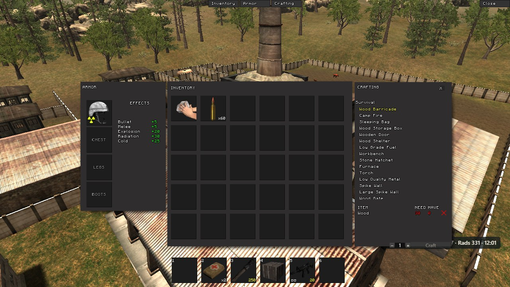</td>
</tr>
<tr><td align="center">Raiding</td><td align="center">Inventory, armor and crafting</td></tr>
<tr>
<td>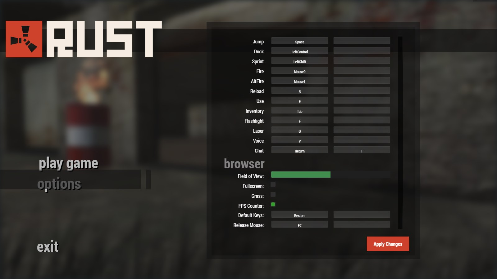</td>
<td>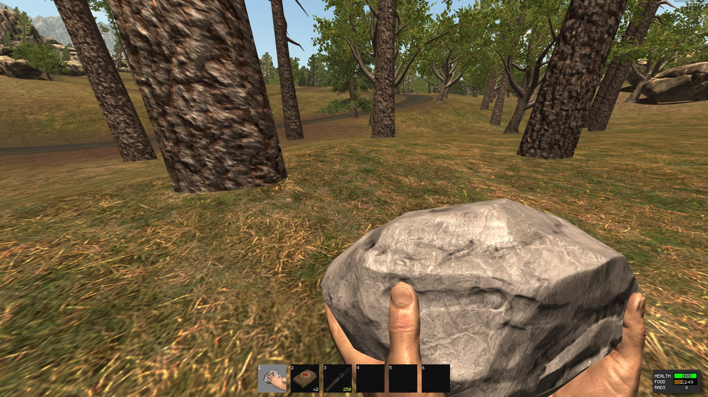</td>
</tr>
<tr><td align="center">Field of View slider (60–120) and FPS counter option</td><td align="center">FPS counter in game (top right)</td></tr>
</table>

## What happens next

1. **First real-server test.** Connect browser players to a real Legacy server through the bridge and check every system end to end.
2. **First PvP server.** Open a PvP server for the community, followed by an EU server.
3. **Community decisions.** Wipe schedule, group limits and server rules are being decided with the players.
4. **New website.** Accounts, server list, island maps and a wiki.
5. **Polish.** Loading time, more hardware and browsers, and the remaining fidelity work.

See the [roadmap](docs/ROADMAP.md) for detail.

## How it will work for players

Visit the website, sign in, choose a server, play. Your account keeps your identity across sessions, so servers recognise you even when your IP changes. Each server keeps its own world, inventory and wipe schedule.

Because the game runs in the browser, there is nothing to install. You don't need a third-party launcher or a modified client to join. [Guide for players and server owners →](docs/PLAYERS-AND-SERVER-OWNERS.md)

## Follow the project

- **Watch** this repository for updates.
- Read the [development journal](docs/DEVLOG.md).
- Use [issues](https://github.com/Complicatons/rust-legacy-browser/issues) for feedback and suggestions. Please read [the contribution guide](CONTRIBUTING.md) first.

The first development commits are dated **16 October 2026**. This public journal started on **17 October 2026**. [Project origin →](docs/PROJECT-ORIGIN.md)

---

**Unofficial community project.** Rust Legacy and its original content belong to their respective rights holders. This project is not affiliated with or endorsed by Facepunch. No original game files, recovered assets or server binaries are distributed here. See [rights and attribution](RIGHTS.md) and the [publication policy](docs/PUBLICATION-POLICY.md).
