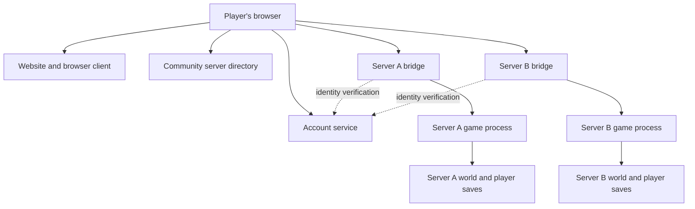

# Proposed accounts, bridge and hosting

**Design proposal, not a description of a deployed service.** Compatibility with original Legacy servers still needs implementation and validation.

## The website

The project website would deliver the browser client, sign-in and server browser. Static client files can be hosted separately from the account and directory services. Players would start at the website and choose a participating server.

## A persistent player identity

The account service would assign an immutable player ID. Display names and IP addresses would not be used as identity keys. For a server join, it would issue a short-lived ticket bound to the chosen server and player. The server-side integration would verify that ticket before accepting the session.

For an original server backend, the bridge must map that identity to a stable backend player identifier accepted by the server's authentication and save system. That integration has not yet been proven. A website account by itself cannot make an unmodified Legacy server accept a browser player.

Each game server would own its own inventories, structures, world state and wipe rules. Reconnecting with the same identity should restore the appropriate state on that server. Items would not automatically transfer between unrelated servers, and a server wipe could still reset progress.

## Community hosting

A participating operator would run a supported game server together with its compatible bridge, register the server and publish a secure browser-accessible bridge endpoint. The directory would show compatible, reachable servers using authenticated registrations and heartbeats. Listing policies and operator controls remain to be designed.

The website can run on the project's infrastructure while community game servers run on other machines and providers. An initial pilot could host all services on one machine, subject to capacity and isolation needs. Separate machines are an operational choice, not a requirement for the basic account model.

## Why the bridge is needed

Ordinary browser pages cannot directly use an arbitrary native game's networking and authentication stack. The bridge would provide a browser-supported secure transport, translate the necessary protocol traffic, and integrate account verification. It should sit close to its game server to reduce latency.

The goal is compatibility with supported Legacy servers. Protocol behaviour, authentication, server changes and any necessary operator permissions must be established before that can be promised. Browsing this website would not automatically grant access to every Legacy server already online.

## Trust boundaries

- Account credentials stay with the website's authentication system; operators receive verified identity assertions rather than website passwords.
- The game server remains authoritative for inventory, damage, movement rules and world changes.
- Server credentials, signing keys and private player data stay out of public client files and this repository.
- Backups and persistence must be tested across disconnects, restarts and upgrades.
