# Development journal

Maintained by [Complicatons](https://github.com/Complicatons). Entries below summarise the existing private Git history; they are not backdated public announcements. The public journal was first prepared on 17 October 2026.

## 19 October 2026 — Desktop interface and player controls

- Rebuilt the inventory around the original separate Armor, Inventory and Crafting windows, with the belt at the bottom. Desktop fidelity is the priority; mobile checks have been replaced with desktop checks.
- Added a saved Field of View slider, synchronized with the original F1 console command. Weapon aiming retains its zoom.
- Added click-to-capture mouse control, Escape or an assigned release key, and optional fullscreen.
- All 306 automated checks pass. RTX 4090 checks verify settings persistence, weapon zoom, mouse capture/release, fullscreen, inventory interactions and crafting. The online project mock-stack regression also passes.
- Continued recovering the original opening-screen assets for the Play, server-browser and loading flow. That reconstruction is still in progress.

Original-engine visual comparison and real Legacy server compatibility remain unfinished. The mock-stack checks do not establish native-server compatibility.

## 19 October 2026 — Inventory interactions

- Added visible item details with original icons, text and weapon bars, plus dragging between inventory slots and containers.
- Online moves wait for server confirmation; replaced inventory snapshots cancel stale drags.
- Added movable desktop panels, original fire/repair cell arrangements, and coloured ingredient requirements with the original status icons.
- All 299 automated checks pass. Focused RTX checks cover pointer gestures and narrow screens; full online mock-server and offline gameplay regressions also pass.

Exact original window placement and dropped-item interactions remain in progress. Native server compatibility still needs the final isolated tests.

## 19 October 2026 — Ragdolls and death presentation

- Added physical ragdolls using the original body shapes, joints, sleep pose and clothed player models.
- Server-confirmed player and sleeper deaths transfer into the physical pose; ordinary player removal creates no corpse. Local death presentation follows the head and restores the camera on respawn.
- All 299 automated checks pass. RTX 4090 checks cover settling, clothing, lifetime, camera transfer and cleanup. The full online mock-server regression verifies death routing and duplicate-message handling.

Browser physics uses a different engine, so exact original motion and contact behaviour remain comparison gaps. Remaining inventory interactions are next; real Legacy server compatibility stays unproven until the final isolated tests.

## 19 October 2026 — Surface-specific impacts

- Connected the original flesh, wood and metal impact assignments to players, wildlife and objects.
- Terrain now selects its impact surface from the original texture weights; ordinary unassigned island scenery keeps the original default effect.
- All 292 automated checks pass. Focused RTX 4090 checks verify flesh/wood/metal effects and terrain selection against the source texture on the GPU. Full online mock-server and offline gameplay regressions also pass.

Exact original-engine particle/shader parity and real Legacy server compatibility remain for final-phase validation. Ragdoll physics and the remaining interface interactions are next.

## 18 October 2026 — Original bullet trails and impact effects

- Replaced the temporary bullet lines with the recovered tracer mesh, texture, fade and travel settings.
- Added original impact particles, sounds and bullet-hole decals, including moving-object attachment and timed cleanup. Silenced shots keep their impact effects while hiding the tracer.
- All 286 automated checks pass. Focused RTX 4090 checks cover the visible tracer, impacts, persistent decals, silenced collisions and cleanup; the full online mock-server and offline gameplay regressions also pass.

Surface selection across the entire island and character-specific impacts remain unfinished. Exact shader/particle parity and real Legacy server compatibility still need final-phase validation; current online checks use the project's own server mock.

## 18 October 2026 — Layered player poses and turning

- Player animations now compose by bone property and layer, preserving walking legs beneath upper-body aiming poses.
- Added the recovered turn-speed limit, smooth direction changes across angle wraparound and independent additive pose ordering.
- All 279 automated checks pass, including tests using the original rifle clips. Focused RTX 4090 checks and the full online mock-server regression pass; the latter now checks that a remote melee swing actually moves the hand and weapon.

Exact original-engine blending and some animation-event interactions still need comparison during the final testing phase. Real Legacy server compatibility remains unverified; current online checks use the project's own server mock.

## 18 October 2026 — Player animation transitions

- Added separate transitions for equipment, crouching, movement and jumping, using recovered timing settings.
- Walking directions share a distance-based animation clock; stopping retains the previous heading, and jump clips hold their final frame instead of looping.
- All 267 automated checks pass. Focused RTX 4090 rendering checks cover the original character skins, movement blends, crouching and jumping. The full online mock-server regression also passes, including animated hit regions, held weapons and inventory interactions.

Exact original animation layering and further presentation work remain unfinished. Real Legacy server compatibility testing is planned for the final phase; current online checks use the project's own server mock.

## 18 October 2026 — Batch crafting and blueprint controls

- Added the original blueprint categories, quantity shortcuts, ingredient totals and crafting progress controls.
- Offline batches consume materials at completion and keep them on cancellation. Workbenches speed crafting and required jobs stop when the player leaves.
- Online quantity requests and cancellation wait for server confirmation; browser timers cannot grant items.
- All 260 automated checks pass, including batch save/resume timing. RTX 4090 checks cover actual batch completion, cancellation and desktop/narrow presentation, plus online paused-job and inventory confirmation checks.

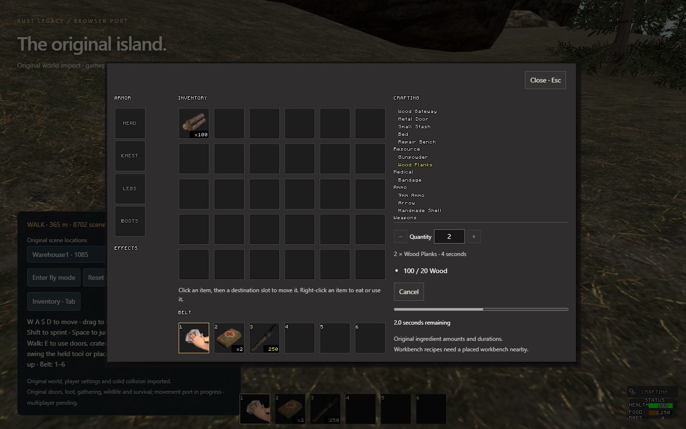

Local prototype capture, 18 October 2026. Window placement and parts of the ingredient display remain adapted. Full interface/animation fidelity and real Legacy server compatibility are unfinished; online checks use the project's own server mock.

## 18 October 2026 — Inventory cells and armour panel

- Restored the original inventory cell graphics, bitmap counts, ammunition labels, attachment-slot indicators and item-condition colours.
- Added the separate armour panel with original slot labels and protection totals. The bag follows the recovered six-by-five grid; the interface reflows for narrow screens.
- All 250 automated checks pass. GPU checks cover equipping a real item, readable tinted text, desktop/narrow layouts and the existing online inventory, loot, crafting and server-confirmation behaviour.

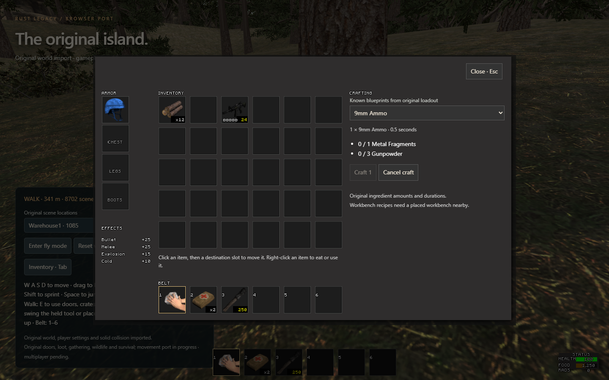

Local prototype capture, 18 October 2026. This restores part of the interface; window arrangement is adapted and the crafting controls, draggable windows, menus and bespoke container layouts remain unfinished. Online checks use the project's own server mock; real Legacy server compatibility remains unverified.

## 18 October 2026 — Movement and camera reactions

- Connected the original movement curves and spring response to walking, strafing and changes in speed, including the weapon's separate motion and reduced strength while aiming.
- Added stacked gunshot and damage camera reactions, with explicit server fall-impact messages affecting only the local player's view.
- Rendering restores the true camera position and direction after drawing. The effects leave gameplay aim and server-controlled health unchanged.
- All 245 automated checks pass. RTX 4090 checks cover real movement, jumping, aiming, shots, damage and settling back to rest. Full online, offline gameplay and first-person attachment checks also pass.

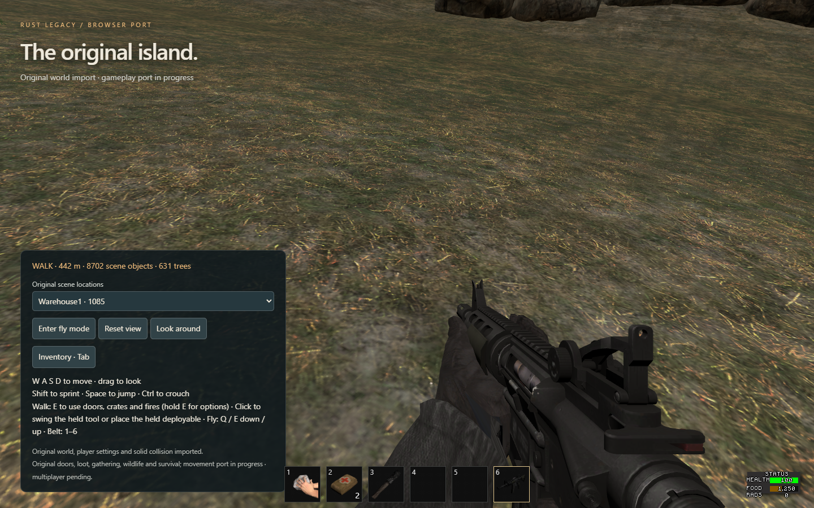

Local browser prototype capture, 18 October 2026. A still image shows the rendered weapon; motion was checked through sampled gameplay frames. Full engine parity, remaining interface/animation work and fall-injury details are unfinished. Development controls remain visible. Online checks use the project's own server mock; compatibility with real Legacy servers remains unverified.

## 18 October 2026 — Weapon attachments and light controls

- Restored the original holo sight, red reticle and silencer, including sight alignment and the altered muzzle position.
- Added flashlight and laser effects for local and remote players, with the original F/G controls and cleanup when weapons change.
- Connected attachment installation to inventory combining. Online installation waits for the server's confirmation; offline weapons retain their available slots and installed mods across saves.
- All 235 automated checks pass. Full online, offline gameplay and viewmodel checks pass on the RTX 4090. Reviewed the aiming and night captures, with an image comparison confirming visible flashlight illumination.

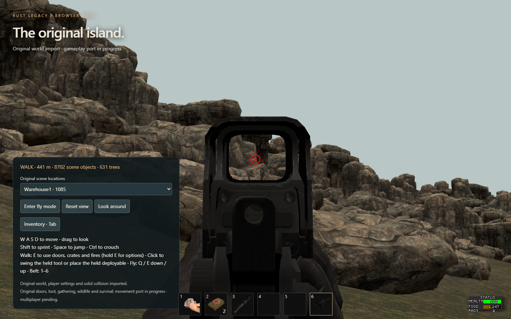

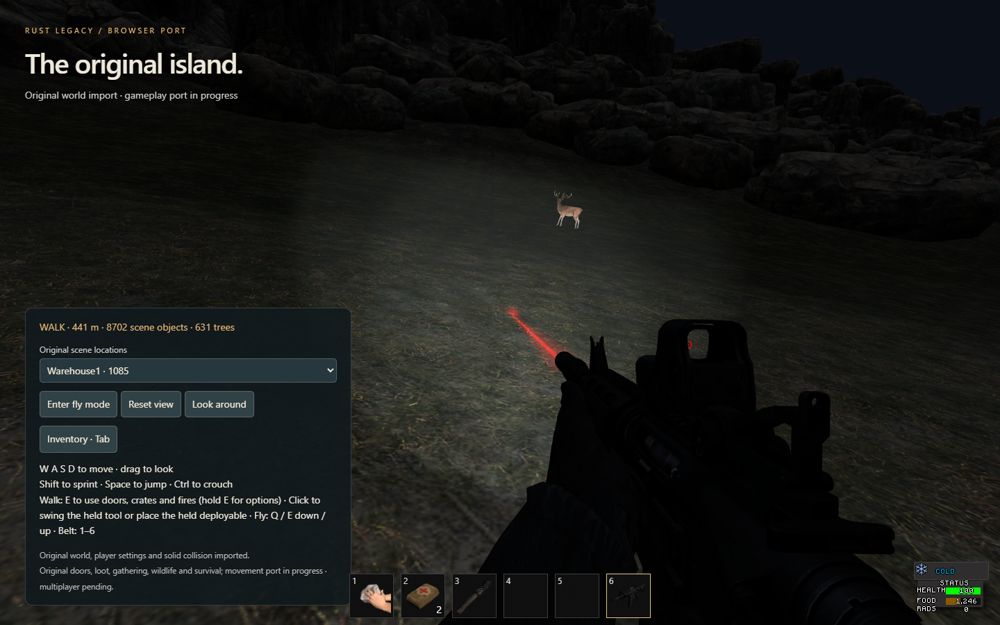

Local browser prototype captures, 18 October 2026. Lighting and laser rendering still approximate parts of the original shaders. Head bob, animation, remaining interface work and other effects are unfinished. Development controls remain visible. Real Legacy server compatibility remains unverified; online checks use the project's own server mock.

## 18 October 2026 — Remote weapons and original muzzle effects

- Connected other players' gunshot sounds, tracers and bow arrows to server messages. Remote silenced gunfire uses its quieter sound and suppresses the visible flash.
- Restored the original muzzle flash and barrel smoke for local and remote firearms, including the brief light and cleanup after firing or switching weapons.
- Smoke stays where it was emitted as the weapon moves. Remote arrows remain visual: damage and inventory stay server-controlled.
- All 227 automated checks pass. The full online interaction check and six-viewmodel gameplay check pass on the RTX 4090, with captures reviewed.

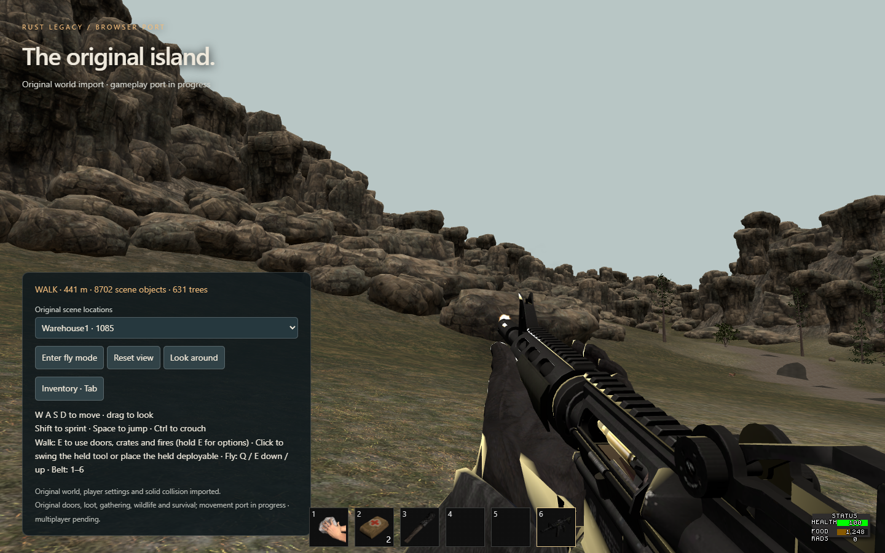

Actual local prototype capture, 18 October 2026. Weapon attachments, head bob, impact effects, animation and interface fidelity still need work. Development controls remain visible. These checks use the project's own server mock; real Legacy server compatibility remains unverified.

## 18 October 2026 — Weapon and camera sway

- Added the original bounded camera sway and weapon pivot movement, including the transition to steady aiming.
- Kept gameplay aim separate from the temporary rendering effect; verified that drawing restores the true eye direction.
- All 219 automated checks pass. Six original viewmodels, torch, bow and firearm actions pass on the RTX 4090, along with the full online combat and placement regression.

Head bob, remaining weapon effects and interface work are still in progress. Results use the project's own local server mock; real Legacy server compatibility remains unverified.

## 18 October 2026 — Original status HUD and bitmap text

- Restored the original status graphics, bitmap font, warning icons and dark belt skin from static asset data.
- Connected health/food bars and warning plaques to the native thresholds, including radiation poisoning rather than any radiation exposure.
- Verified the status display through online and offline RTX 4090 gameplay checks. All 215 automated checks pass.

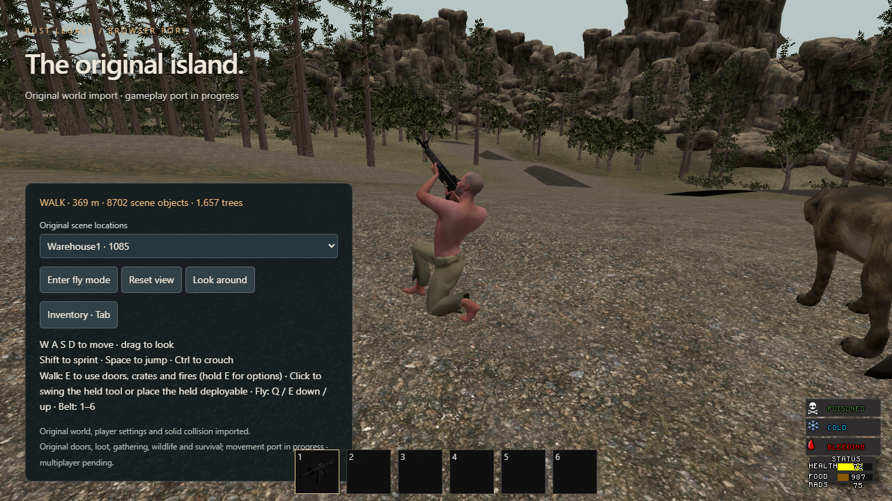

Actual local mock-server capture, 18 October 2026. This is the first HUD restoration pass; inventory-window layout, camera effects and other presentation details are still unfinished. Development controls remain visible. Real Legacy server compatibility remains unverified.

## 18 October 2026 — Remote torches, melee and door codes

- Added server-driven remote torch flame/light and the original melee swing animation, with cleanup when an item is extinguished or removed.
- Connected door-code entry to the server's menu requests and responses. Invalid input stays in the window; valid codes are submitted for the server to check.
- Added the offline door ownership and lock menus, and checked the input window on a narrow screen.
- All 212 automated checks pass. Online and offline gameplay checks pass on the RTX 4090.

These remain local prototype results through the project's own server mock. Interface fidelity, remaining effects and real Legacy server compatibility still need work.

## 18 October 2026 — Other players' held items and aiming

- Added the original third-person item representations and hand attachments, driven by server-created items.
- Verified twelve representative item types, switching, movement and cleanup. The recovered data maps 53 items to the original shared world models.
- Connected armed walking/crouching and upper-body aiming. Fixed the network look-angle direction and checked that weapons rise and lower with the remote player's aim.
- All 209 automated checks pass. The full online interaction check passes on the RTX 4090.

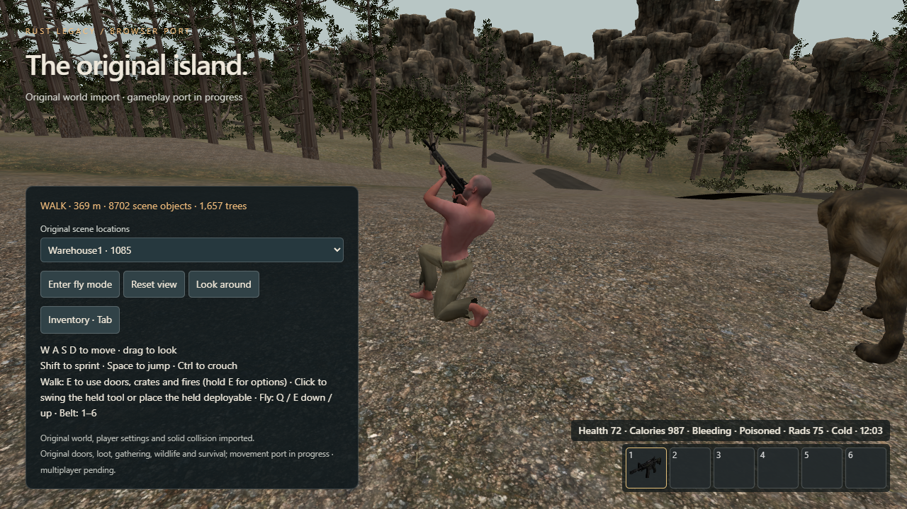

Actual local mock-server capture, 18 October 2026. Full animation fidelity, remote attack effects, item modifications and interface work remain unfinished. Real Legacy server compatibility remains unverified.

## 18 October 2026 — Online building placement and world cleanup

- Connected building and deployable previews to the online world. Pieces snap to the building groups supplied by the server.
- Placement sends a request; the server creates the piece and updates inventory. Verified new foundations, snapped pillars and storage-box requests through the local server mock.
- Fixed cleanup when server groups leave view, including old objects, collision and state when an area returns.
- All 204 automated checks pass. RTX 4090 checks cover the full online connection path and offline gameplay.

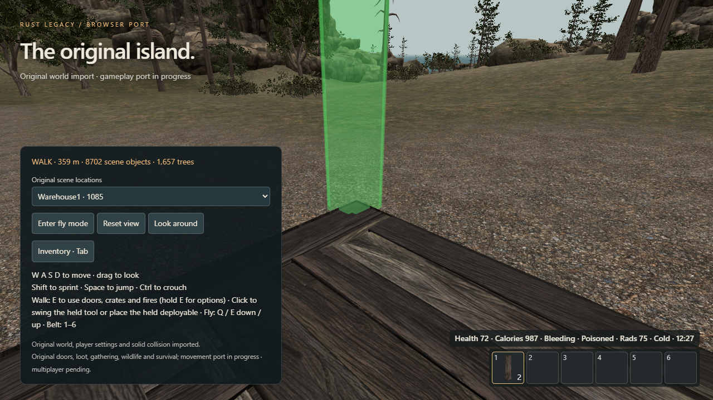

Actual local mock-server capture, 18 October 2026. Other players' held items, animation and interface fidelity are still in progress. Real Legacy server compatibility remains unverified; there is no public playable release yet.

## 18 October 2026 — Online grenades and flares

- Connected grenade throws, supply signals, flares and torch activation to the online stack.
- World projectiles follow server updates. Explosions and signal clouds appear when the server confirms completion; the browser does not apply its own online damage or consume inventory.
- Added original flare sound, world flame and light presentation.
- All 200 automated checks pass. RTX 4090 checks cover online projectile effects, offline gameplay and the original held-item models.

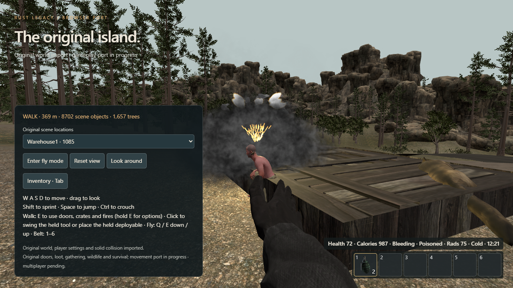

Actual local mock-server capture, 18 October 2026. Online building placement is the next integration task. Original presentation fidelity and real Legacy server compatibility remain unfinished. Implementation and recovered assets stay private.

## 18 October 2026 — Online bows and arrow flight

- Connected bow drawing, cancellation, firing and predicted arrow flight to the online stack.
- Verified player hits and expiring arrows through the server mock. Arrow counts change only when the server confirms them.
- Added arrows that follow the moving target they hit and clean up when the old character is replaced.
- All 195 automated checks pass. RTX 4090 checks cover online bow actions, offline bow damage and the original held-item models.

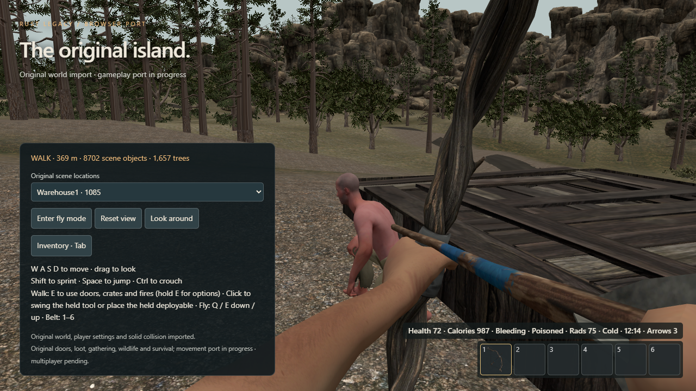

Actual local mock-server capture, 18 October 2026. The interface is unfinished. Online throwables, placement, remote attack presentation and real Legacy server compatibility remain outstanding. Implementation and recovered assets stay private.

## 18 October 2026 — Online melee, gathering and audio

- Connected melee swings and delayed hit reports to the online stack, using original tool timing and client tree limits.
- Verified ore and tree interactions through the server mock. Gathering rewards appear only when the server updates inventory; the browser does not grant items or apply damage itself.
- Recovered the original swing and wood-impact sounds. Fixed audio activation from normal player input and support for the original uncompressed audio files.
- All 192 automated checks pass. Online gameplay and browser audio decoding were verified on the RTX 4090.

These are local prototype results through our own server mock. Real Legacy server compatibility, online bows/throwables/placement, remote attack animations and original impact effects still need work.

## 17 October 2026 — Online firearms and animated hit regions

- Connected browser firearm shots and reload requests to the online connection stack. Recoil, aiming and original first-person animations run in the browser; inventory counts and damage remain server-owned.
- Added the original player's 23 animated hit regions, following the head, torso and limbs through standing, walking and crouching poses.
- Added server wildlife collision for targeting and checked player, animal and world-object shot reports through the project's own server mock.
- Verified online combat, offline gameplay and original viewmodels on the RTX 4090. All 187 automated checks pass.

Real Legacy server interoperability remains unverified. Melee, bows, throwables and placement still need online integration; animation, effects and interface fidelity also remain unfinished. There is no public playable release yet.

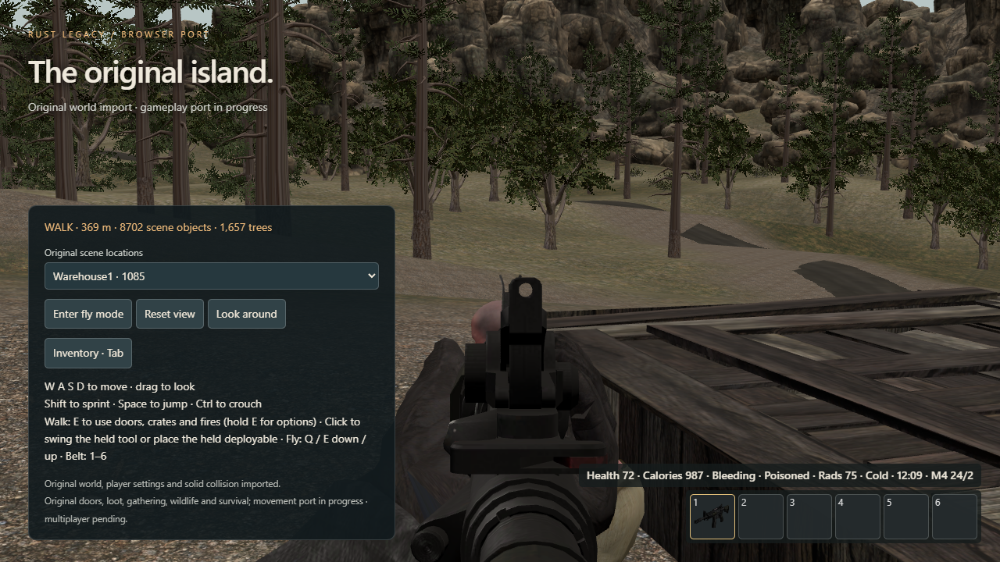

Actual local prototype capture, 17 October 2026. Development controls remain visible. Implementation, detailed protocol notes and recovered assets stay private.

## 17 October 2026 — Online inventory, equipment and respawn

- Connected the inventory and crafting windows to server updates. Moving items, taking loot and crafting send requests; item counts change when the server confirms them.
- Added original clothing changes for remote players, original loot sacks and clothed sleeping-player models with collision.
- Connected server health, bleeding and metabolism, plus death and respawn. Clicking Respawn waits for the server to create and place a new character.
- Verified the online flows and narrow inventory layout on the RTX 4090. All 182 automated checks pass; the offline gameplay/save/repair regressions also pass.

These are prototype checks through our own server mock. Real Legacy server interoperability, combat/placement routing, full animation/HUD fidelity and production hosting still need work. There is no public playable release yet.

| Server inventory | Original sleeper and loot models |
| --- | --- |
| 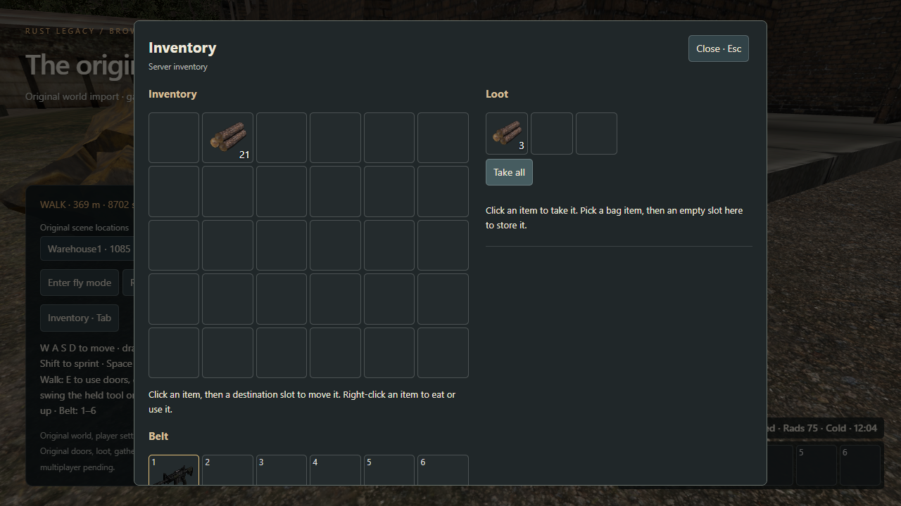 | 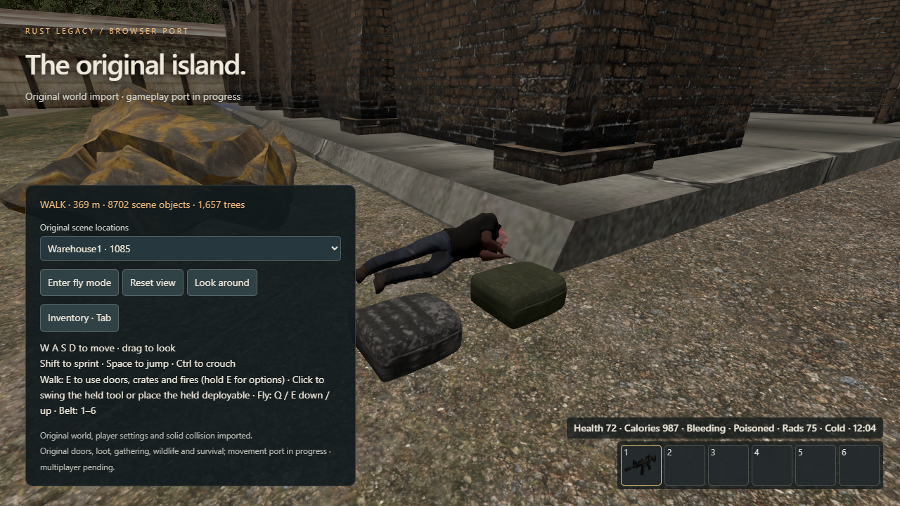 |

Actual local prototype captures from 17 October 2026. Implementation, detailed engineering notes and recovered game assets remain private.

## 17 October 2026 — GPU validation and online presentation

- Verified full gameplay, save/reload, repair and first-person held models on an NVIDIA RTX 4090 in Microsoft Edge/WebGL2.
- Added original remote-player models and unarmed movement animations, plus server-driven wildlife movement, attack and death presentation.
- Added original online campfire flames, smoke, sparks and light, controlled by server state.
- Checked the website-to-game join through the account service, gateway and server adapter using the project's own UDP server mock. Website and two-client transport checks also pass.
- Kept engineering checkpoints and AI handoff notes current in the private implementation repository.

The connection stack is implemented and mock-tested. **No real Legacy server interoperability has been demonstrated yet.** Online inventory, equipment and several gameplay actions remain unfinished. Remote clothing/held items, full animation blending and the original HUD still need work; this is not a public playable release.

| Original M4 sights | Online campfire effects |
| --- | --- |
| 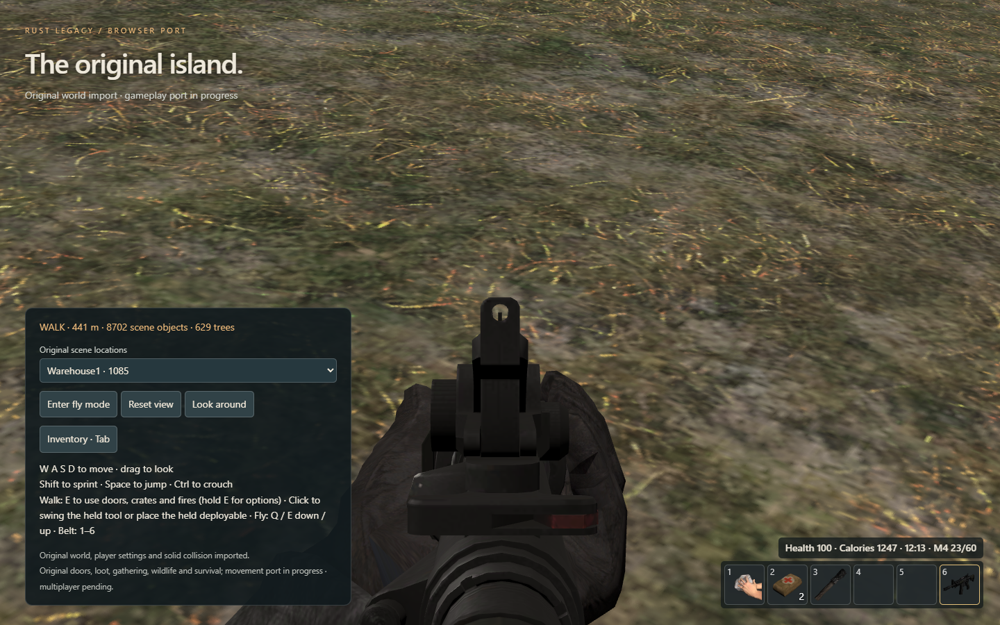 | 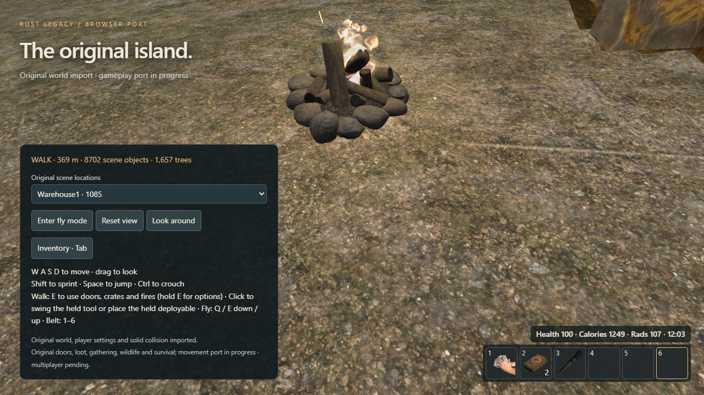 |

Actual local prototype captures from 17 October 2026, with unfinished development controls visible. The campfire capture uses our mock server through the full connection stack.

## 17 October 2026 — Combat and environmental survival

- Added local firearm, bow, grenade and explosive-charge behaviour, with wearable armour. Weapon viewmodels, hitboxes and several effects remain unfinished.
- Connected the recovered day/night clock to changing light and survival. Night cold consumes extra calories; clothing and lit fires offer protection.
- Connected the original radiation zones, wearable radiation protection and existing radiation metabolism/anti-rad items.
- Continued browser interaction checks and recorded clear handoff checkpoints so development can move between assistants.

This remains a local prototype. Sky and material rendering approximate the original presentation. These changes do not establish original-server compatibility or a public playable release. The selected gateway/server-adapter route remains the planned path to shared browser/desktop servers.

Validation: 78 automated logic/data checks pass. The installed Edge gameplay and narrow-layout check passes, including night cold, fire warmth and radiation protection, with no page/console errors or external requests. A separate two-client check passes for our local movement transport; it does not use an original Legacy server.

| Day | Night |
| --- | --- |
| 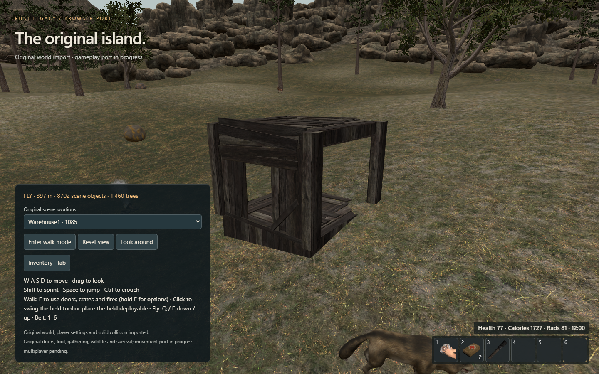 | 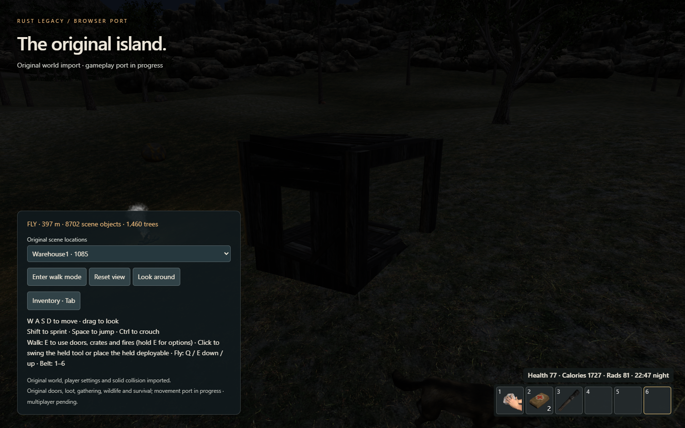 |

Actual local prototype captures from 17 October 2026. The damaged hut follows the building/combat test; development controls and unfinished visuals are visible.

## 17 October 2026 — Building and camp life

Networking planning update: investigated existing-server gateway options and historical Legacy approval hooks. Added [the server integration plan](SERVER-INTEGRATION.md), distinguishing unchanged-server access from operator-installed identity adapters. No native server connection has yet been demonstrated.

- Work on deployables, cooking and camp respawn.
- Building work covering structures, hardpoints and placed doors.
- Public project journal prepared with screenshots, roadmap and an origin record.

Private history references: `0998755` and `bb26ba1`. The three screenshots in the main README show this day's local prototype. These are development snapshots, not a published multiplayer release.

## 16 October 2026 — Establishing the browser port

- Initial project committed.
- Imported world exploration, doors and loot.
- Resource gathering and item export corrections.
- Rebuilt the visible world from the client scene, corrected sea level and worked on wildlife.
- Metabolism, bleeding, eating and medical item work.

Private history references: `645c5e5`, `b77a132`, `d7673c3`, `c759f55` and `c579f99`.

## Next journal entries

Future entries should include a date, a concrete change, a screenshot or other evidence where useful, and known limitations. Performance and compatibility claims should identify how they were measured. Releases will be announced explicitly when a public playable build exists.
