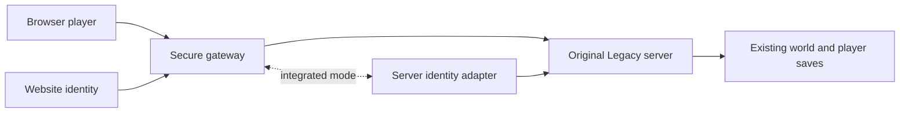

# Connecting existing Legacy servers

17 October 2026. Researched design; no original-server interoperability demonstrated yet.

For a plain-language explanation, read [the player and server-owner guide](PLAYERS-AND-SERVER-OWNERS.md).

**First-release decision:** participating operators will install a gateway plus server identity adapter. Unchanged-server access remains later research; the first release does not depend on solving it. Existing players will need a verified one-time link to retain an existing server identity. New browser identities will be offered only where the supported server profile can safely allocate them.

The goal is to keep the original Legacy server authoritative and let browser players join its world. The gateway is a networking and admission component, not a replacement survival game server.

## Two routes

| Route | Operator installation | Current position |
| --- | --- | --- |
| Hosted gateway to unchanged server | Potentially none | Conditional on reproducing its protocol and satisfying legitimate per-player authentication |
| Gateway plus server identity adapter | A compatible plugin, extension or controlled server integration | Preferred supported route if unchanged native authentication cannot work from a browser |

The gateway may run beside a server or on nearby project infrastructure. Each player needs a distinct native session. A gateway adds network translation; it does not automatically solve authentication, gameplay message compatibility or persistence.

## Why authentication matters

The inspected desktop connection separates a display name, numeric player identity and authentication ticket. A familiar username-only screen does not mean the server uses the name as a permanent account key. Identity generation in different community packages must be checked; hardware-ID derivation has not been established for the supplied client.

A website login would create a stable platform identity. Steam OpenID can additionally prove a Steam account for linking, but it is a separate flow from native game-session authentication. [Steam authentication documentation](https://partner.steamgames.com/doc/features/auth)

In integrated mode, the server adapter would verify a short-lived, server-specific admission ticket and bind it to the exact incoming player session before spawn. Native desktop authentication would retain its normal path. The server owner would deliberately enable browser admission.

## Keeping existing characters

Where an adapter is installed, a player could request a one-use linking challenge from their already authenticated desktop character and redeem it while signed into the website. After conflict and ownership checks, the browser identity could map to that existing server identity. Names, IP addresses and manually entered IDs would not be sufficient proof.

Existing inventories and building ownership would remain keyed to the server's existing identity. New browser players would receive durable mappings. Saves stay per server and remain subject to wipes. On unchanged servers, restoring desktop progress requires a verified native authentication route for that same identity.

## Implementation gates

1. Identify one exact pilot server build, authentication profile, protection requirements and supported hooks.
2. Prove a legitimate authentication route and precise connection-to-account binding. Select unchanged or integrated mode.
3. Document and test native handshake, serialization, replication and gameplay messages against authorised evidence.
4. Demonstrate browser approval, world load and authoritative player spawn on the original server.
5. Test two browser players and a native player where supported, including shared interactions and reconnects.
6. Prove identity, inventory and ownership persistence across browser changes, server restart and backup restoration.
7. Package installation, diagnostics, secure configuration and rollback; repeat on a second independent host.
8. Run a limited measured pilot before broader directory listing.

Secure WebSocket is the proposed first diagnostic transport; datagram-capable transports may be evaluated for gameplay after measurement. Both require a compatible browser-facing endpoint. [WebSocket documentation](https://developer.mozilla.org/en-US/docs/Web/API/WebSockets_API), [WebTransport documentation](https://developer.mozilla.org/en-US/docs/Web/API/WebTransport_API)

Historical [Oxide Legacy source](https://github.com/OxideMod/Oxide.RustLegacy/blob/develop/src/RustLegacyHooks.cs) exposes approval-related hooks, but the framework is archived and the precise insertion point must be verified. Modern Rust plugins are not automatically Legacy-compatible. Some builds may require a dedicated extension rather than a drop-in plugin.

No current online server is being advertised as browser-compatible. The existing local multiplayer harness is not an original-server compatibility test. No live community game server was contacted in this investigation.
